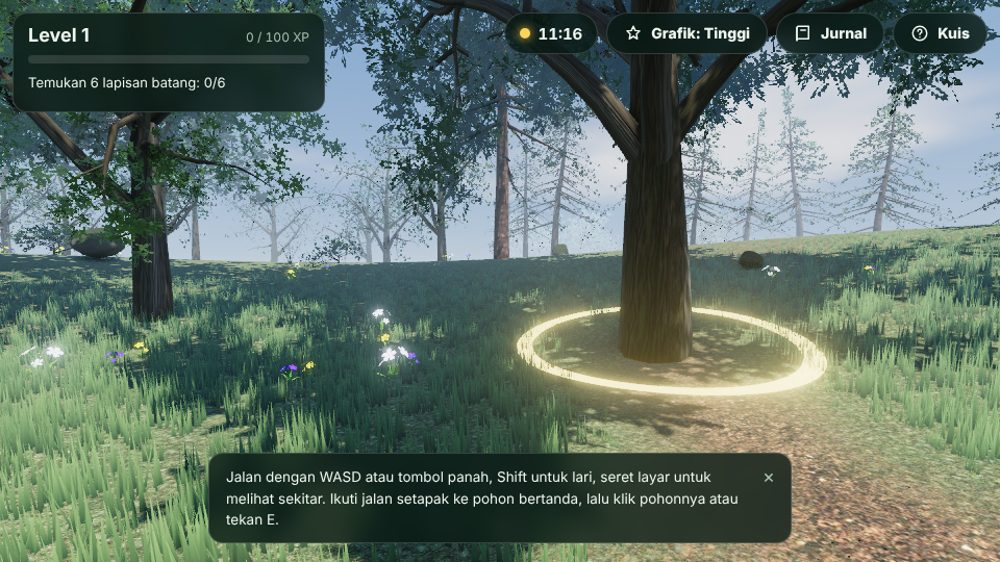
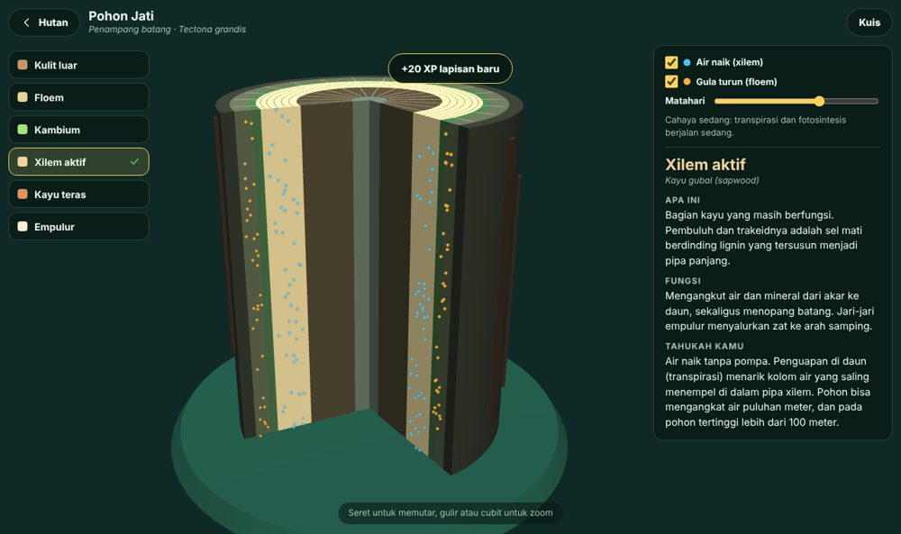

# Hutan Ilmu

Game edukasi 3D di browser. Jelajahi hutan dari sudut pandang orang pertama, dekati pohon bertanda, lalu bedah batangnya sampai kulit luar, floem, kambium, xilem, kayu teras, dan empulur. Ada jurnal, XP, misi, dan kuis.

Pola interaksi: klik, zoom, info, mini-interaksi, kuis ringan. Pola yang sama nanti dipakai ulang untuk objek lain dan simulasi kerja.

| Sebelum (low-poly) | Sesudah (branch `realistic`) |
|---|---|
|  |  |
|  |  |

Tampilan "Hemat" dan senja: `docs/sesudah-hutan-hemat.jpg`, `docs/sesudah-senja.jpg`. Tampilan HP: `docs/sesudah-hp.jpg`.

## Jalankan

Modul ES butuh server (tidak bisa dibuka lewat `file://`). `dist/` sudah ikut di repo, jadi tidak perlu build untuk sekadar menjalankan:

```bash
python3 -m http.server 8000
```

Buka http://localhost:8000. Untuk mengubah kode:

```bash
npm install
npm run build      # menghasilkan dist/game.js + dist/assets/
npm run dev        # build ulang otomatis saat file berubah
```

Tambahkan `?debug` di URL untuk membuka `window.__hi` (hook uji) dan `&q=hemat` / `&q=tinggi` untuk memaksa kualitas.

Kontrol: WASD atau panah untuk jalan, Shift untuk lari, Spasi untuk lompat (di HP: tombol panah kanan bawah), gulir/cubit atau tombol +/− (juga tombol + dan -) untuk zoom, seret layar untuk melihat sekitar, E atau klik pohon untuk membedah, J untuk jurnal, Esc untuk kembali. Di HP ada joystick kiri bawah.

## Kualitas grafik

Tombol **Grafik** di kanan atas, tersimpan di `localStorage`.

- **Tinggi**: bayangan 2048, GTAO (ambient occlusion), bloom, rumput lebih rapat, pohon lebih banyak dan jauh. Default di desktop.
- **Hemat**: bayangan 1024, tanpa AO dan bloom, pixel ratio maksimal 1,25, pohon dan rumput dikurangi. Default di layar sentuh.
- Kalau di Tinggi rata-rata di bawah sekitar 30 fps selama 4 detik pertama, game turun sendiri ke Hemat.

## Teknik

- Langit prosedural (gradien, awan fbm, matahari HDR, bintang) yang digerakkan siklus siang-malam 240 detik. Kubah yang sama dirender ke PMREM untuk cahaya sekitar (IBL), dan warna cakrawalanya dipakai untuk kabut.
- Tone mapping ACES lewat satu pipeline EffectComposer (MSAA HDR, GTAO, bloom, output), sama untuk kedua kualitas.
- Medan bertekstur PBR (rumput + tanah + pasir, jalan setapak ke tiap pohon bertanda), air berbasis kedalaman (warna dangkal ke dalam, buih tepi, tiga lapis riak, kilau matahari).
- Kucing prosedural berkeliaran di dekat jalan setapak. Dibedah berlapis (kulit dan bulu, otot, rangka, 8 organ) dengan slider Kedalaman dan Aktivitas (jantung berdetak dan paru mengembang sesuai kisaran umum, aliran makanan di saluran cerna), plus kuis sendiri. Data di src/objects/kucing.js, model di src/species/kucing.js. Perlu validasi dokter hewan.
- Lima spesies pohon bisa dibedah, masing-masing dengan bentuk, tekstur penampang, fakta, dan kuis sendiri: jati, mahoni, beringin, pinus merkusii, trembesi. Kuis hanya memuat spesies yang sudah dibedah. Isi sains perlu divalidasi guru biologi atau ahli kehutanan.
- Pohon dihasilkan prosedural dengan [ez-tree](https://github.com/dgreenheck/ez-tree), disebar per chunk 40 m dengan InstancedMesh dan dua level detail (dekat dan jauh). Pohon bertanda dibuat dari preset besar.
- Rumput dirender di GPU (InstancedBufferGeometry): posisinya membungkus di sekitar pemain, tinggi tanah dihitung ulang di shader, bergoyang oleh angin.
- Bedah batang: sektor cincin hasil ExtrudeGeometry. Penampang ujung memakai tekstur kanvas prosedural (cincin tahun, jari-jari empulur, batas lapisan), sisi potongan memakai tekstur serat, kulit luar memakai tekstur kulit kayu PBR.

## Struktur

```
index.html            halaman utama + HUD
css/style.css         tampilan dan HUD
src/main.js           state, UI, input, loop
src/sky.js            langit, cahaya, kabut, IBL
src/terrain.js        medan, jalan setapak, air
src/vegetation.js     pohon, semak, rumput, batu, bunga
src/dissect.js        scene bedah batang + tekstur prosedural
src/fx.js             post-processing
src/objects/pohon.js  data objek "pohon": lapisan, spesimen, kuis
dist/                 hasil build (di-commit supaya bisa langsung di-host)
assets/models/        batu dan bunga (GLB), assets/draco/ decoder Draco
```

## Menambah objek edukasi

Satu objek adalah satu file di `src/objects/`, berisi nama, lapisan beserta teks infonya, spesimen di dunia, dan kuis. Salin `pohon.js` sebagai contoh. Saat ini `main.js` baru membaca objek `pohon`; membuat engine memilih objek secara dinamis adalah langkah berikutnya.

## Hosting

Karena hasil build berupa file statis, cukup:

- **GitHub Pages**: Settings, Pages, pilih branch dan folder `/ (root)`. Repo harus publik kalau akun GitHub gratis.
- **Vercel atau Netlify**: hubungkan repo. Tanpa build command (atau `npm run build`), folder output `/`.

## Catatan

- Progres (XP, jurnal) tersimpan di `localStorage` browser masing-masing pemain.
- Jenis pohon di hutan memakai preset ez-tree (ek, ash, aspen, pinus) sebagai pendekatan visual, bukan spesies tropis yang akurat. Jati, mahoni, dan beringin di dunia juga tampil dari preset terdekat. Konten sains di panel bedah tetap spesifik per lapisan.
- Warna kambium dibuat hijau supaya mudah dikenali di game; pada kayu asli lapisan ini sangat tipis dan hampir tak berwarna.
- Konten sains belum divalidasi guru biologi. Lakukan validasi sebelum dipakai di sekolah.

## Kredit dan lisensi

- [three.js](https://threejs.org) (MIT).
- [ez-tree](https://github.com/dgreenheck/ez-tree) oleh Daniel Greenheck (MIT, lihat `assets/EZ-TREE.LICENSE`): generator pohon, tekstur kulit kayu dan daun, tekstur rumput dan tanah, model batu dan bunga. Tekstur kulit kayu berasal dari Poly Haven (oak, willow) dan TextureCan (birch, pine); lihat sumber asli di README ez-tree sebelum dipakai secara komersial.
- Draco decoder dari three.js (Apache-2.0).

Suara: angin, burung (siang), jangkrik (malam), dan meong kucing dibuat prosedural dengan Web Audio (src/audio.js), tanpa file aset. Tombol Suara di kanan atas untuk menyalakan atau mematikan.

Air: danau bisa dimasuki. Di air dangkal langkah melambat dan tiap langkah memercik; di bagian dalam pemain berenang (lihat ke bawah sambil maju untuk menyelam, Spasi/tombol panah untuk naik, C untuk turun). Ada riak di shader air, partikel cipratan, tetes air di layar, kabut dan suara teredam di bawah air, serta kaustik di dasar danau.

Hewan: mesin hewan generik di src/animal.js (rakit tubuh berengsel, berkeliaran, adegan bedah berlapis, mata dengan bentuk pupil per spesies). Tiap spesies satu spec di src/species/ (kucing, sapi, kambing) plus data edukasi di src/objects/. Sapi perah FH dan kambing PE ada di padang berpagar dekat beringin; organ ruminansia (rumen, retikulum, omasum, abomasum, ambing) dengan animasi memamah biak (titik hijau) dan kontraksi rumen. Perlu validasi dokter hewan atau ahli peternakan.

Ikan: 5 ikan air tawar (mas, nila, lele, gurami, arwana) dibuat oleh generator parametrik di src/fish.js dari parameter di src/objects/ikan.js. Ikan berenang berkelompok di danau (instanced, ekor meliuk lewat shader) dan bisa dibedah saat pemain berenang di dekatnya. Bedah ikan: sisik dan gurat sisi, miomer, rangka dan jari-jari sirip, insang, jantung dua ruang, gelembung renang (dua ruang pada ikan mas), organ arborescent lele, organ labirin gurami. Minigame: atur gelembung renang sampai ikan melayang (XP), dan bandingkan aliran insang berlawanan arah dengan searah. Perlu validasi ahli perikanan.

Monokotil: kelapa (tepi danau, dengan beberapa kelapa hiasan) dan rumpun bambu apus, dibuat prosedural di src/monocot.js, data di src/objects/monokotil.js. Bedah penampang batang memperlihatkan berkas pembuluh tersebar (kolateral tertutup), tanpa kambium dan tanpa cincin tahun; bambu dengan buluh berongga, buku dan sekat. Slider Matahari mengatur aliran air (xilem) dan gula (floem). Perlu validasi guru biologi.

Daun dan fotosintesis: anakan jati dekat titik awal (src/leaf.js, data src/objects/daun.js). Satu adegan dengan tiga tingkat Perbesaran: helai daun (tulang menyirip), penampang jaringan (kutikula, epidermis, palisade, bunga karang, berkas pengangkut, stomata dengan sel penjaga yang membuka-menutup), dan kloroplas (membran, grana, stroma). Minigame faktor pembatas: atur Cahaya, CO2, dan Air; stomata menutup saat gelap atau kekurangan air; laju 100% selama 2 detik memberi XP. Partikel: CO2 masuk, O2 keluar, air naik lewat xilem, gula lewat floem, foton ke grana. Perlu validasi guru biologi.

Hewan ronde 3: ayam kampung (dua kaki, kantong udara dengan aliran udara satu arah, tembolok, ampela, oviduk), kupu-kupu jeruk (sayap bersisik yang mengepak, trakea, mata majemuk, probosis, pembuluh punggung, tubulus Malpighi) dan katak sawah (melompat, kulit lembap, jantung tiga ruang, lidah di depan mulut). Kupu-kupu dan katak punya model tahap siklus hidup (telur, ulat/berudu, kepompong/katak muda) yang bisa diketuk. Mesin hewan kini mendukung jumlah kaki bebas, sayap, terbang, dan melompat. Suara petok ayam dan kuak katak prosedural. Perlu validasi dokter hewan atau guru biologi.

Bumi dan lingkungan (src/geo.js, data src/objects/geo.js): profil tanah (horizon O, A, B, C, R, akar, cacing; slider Hujan memperlihatkan air meresap), singkapan batuan dengan siklus batuan (andesit, batu pasir, marmer, magma; partikel proses pelapukan, panas dan tekanan, meleleh, membeku), dan papan siklus air di tepi danau yang membuka diorama gunung, hutan, sungai, dan danau (evaporasi, transpirasi, kondensasi, hujan, limpasan, infiltrasi; slider Hutan memperlihatkan banjir dan sungai keruh saat hutan gundul). Perlu validasi guru IPA atau geografi.

Sungai: alur sungai dari perbukitan barat laut ke danau diukir di medan (rumus sama di JS dan GLSL, src/terrain.js). Muka air dibuat selalu menurun ke hilir, permukaannya bergerak searah arus, rumput dan pohon menghindari alur, pemain bisa menyeberang sambil memercik, dan ada suara gemericik yang makin keras saat mendekat.
