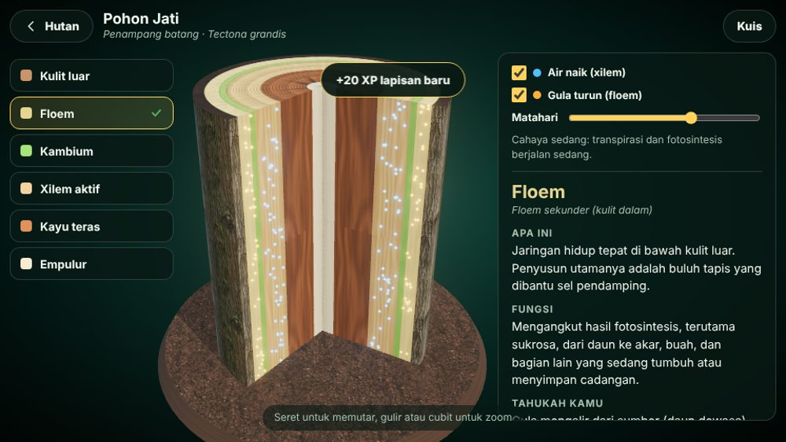

# Pengetahuan Dunia

(Dulu bernama Hutan Ilmu. Hutan di tengah pulau tetap bernama Hutan Ilmu.)

Game edukasi 3D di browser. Jelajahi hutan dari sudut pandang orang pertama, dekati pohon bertanda, lalu bedah batangnya sampai kulit luar, floem, kambium, xilem, kayu teras, dan empulur. Ada jurnal, XP, misi, dan kuis.

Pola interaksi: klik, zoom, info, mini-interaksi, kuis ringan. Pola yang sama nanti dipakai ulang untuk objek lain dan simulasi kerja.

| Sebelum (low-poly) | Sesudah (branch `realistic`) |
|---|---|
|  |  |
|  |  |

Tampilan "Hemat" dan senja: `docs/sesudah-hutan-hemat.jpg`, `docs/sesudah-senja.jpg`. Tampilan HP: `docs/sesudah-hp.jpg`.

## Jalankan

Modul ES butuh server (tidak bisa dibuka lewat `file://`). `dist/` sudah ikut di repo, jadi tidak perlu build untuk sekadar menjalankan:

```bash
python3 -m http.server 8000
```

Buka http://localhost:8000. Untuk mengubah kode:

```bash
npm install
npm run build      # menghasilkan dist/game.js + dist/assets/
npm run dev        # build ulang otomatis saat file berubah
```

Tambahkan `?debug` di URL untuk membuka `window.__hi` (hook uji) dan `&q=hemat` / `&q=tinggi` untuk memaksa kualitas.

Kontrol: WASD atau panah untuk jalan, Shift untuk lari, Spasi untuk lompat (di HP: tombol panah kanan bawah), gulir/cubit atau tombol +/− (juga tombol + dan -) untuk zoom, seret layar untuk melihat sekitar, E atau klik pohon untuk membedah, J untuk jurnal, Esc untuk kembali. Di HP ada joystick kiri bawah.

## Kualitas grafik

Tombol **Grafik** di kanan atas, tersimpan di `localStorage`.

- **Tinggi**: bayangan 2048, GTAO (ambient occlusion), bloom, rumput lebih rapat, pohon lebih banyak dan jauh. Default di desktop.
- **Hemat**: bayangan 1024, tanpa AO dan bloom, pixel ratio maksimal 1,25, pohon dan rumput dikurangi. Default di layar sentuh.
- Kalau di Tinggi rata-rata di bawah sekitar 30 fps selama 4 detik pertama, game turun sendiri ke Hemat.

## Teknik

- Langit prosedural (gradien, awan fbm, matahari HDR, bintang) yang digerakkan siklus siang-malam 240 detik. Kubah yang sama dirender ke PMREM untuk cahaya sekitar (IBL), dan warna cakrawalanya dipakai untuk kabut.
- Tone mapping ACES lewat satu pipeline EffectComposer (MSAA HDR, GTAO, bloom, output), sama untuk kedua kualitas.
- Medan bertekstur PBR (rumput + tanah + pasir, jalan setapak ke tiap pohon bertanda), air berbasis kedalaman (warna dangkal ke dalam, buih tepi, tiga lapis riak, kilau matahari).
- Kucing prosedural berkeliaran di dekat jalan setapak. Dibedah berlapis (kulit dan bulu, otot, rangka, 8 organ) dengan slider Kedalaman dan Aktivitas (jantung berdetak dan paru mengembang sesuai kisaran umum, aliran makanan di saluran cerna), plus kuis sendiri. Data di src/objects/kucing.js, model di src/species/kucing.js. Perlu validasi dokter hewan.
- Lima spesies pohon bisa dibedah, masing-masing dengan bentuk, tekstur penampang, fakta, dan kuis sendiri: jati, mahoni, beringin, pinus merkusii, trembesi. Kuis hanya memuat spesies yang sudah dibedah. Isi sains perlu divalidasi guru biologi atau ahli kehutanan.
- Pohon dihasilkan prosedural dengan [ez-tree](https://github.com/dgreenheck/ez-tree), disebar per chunk 40 m dengan InstancedMesh dan dua level detail (dekat dan jauh). Pohon bertanda dibuat dari preset besar.
- Rumput dirender di GPU (InstancedBufferGeometry): posisinya membungkus di sekitar pemain, tinggi tanah dihitung ulang di shader, bergoyang oleh angin.
- Bedah batang: sektor cincin hasil ExtrudeGeometry. Penampang ujung memakai tekstur kanvas prosedural (cincin tahun, jari-jari empulur, batas lapisan), sisi potongan memakai tekstur serat, kulit luar memakai tekstur kulit kayu PBR.

## Struktur

```
index.html            halaman utama + HUD
css/style.css         tampilan dan HUD
src/main.js           state, UI, input, loop
src/sky.js            langit, cahaya, kabut, IBL
src/terrain.js        medan, jalan setapak, air
src/vegetation.js     pohon, semak, rumput, batu, bunga
src/dissect.js        scene bedah batang + tekstur prosedural
src/fx.js             post-processing
src/objects/pohon.js  data objek "pohon": lapisan, spesimen, kuis
dist/                 hasil build (di-commit supaya bisa langsung di-host)
assets/models/        batu dan bunga (GLB), assets/draco/ decoder Draco
```

## Menambah objek edukasi

Satu objek adalah satu file di `src/objects/`, berisi nama, lapisan beserta teks infonya, spesimen di dunia, dan kuis. Salin `pohon.js` sebagai contoh. Saat ini `main.js` baru membaca objek `pohon`; membuat engine memilih objek secara dinamis adalah langkah berikutnya.

## Hosting

Karena hasil build berupa file statis, cukup:

- **GitHub Pages**: Settings, Pages, pilih branch dan folder `/ (root)`. Repo harus publik kalau akun GitHub gratis.
- **Vercel atau Netlify**: hubungkan repo. Tanpa build command (atau `npm run build`), folder output `/`.

## Catatan

- Progres (XP, jurnal) tersimpan di `localStorage` browser masing-masing pemain.
- Jenis pohon di hutan memakai preset ez-tree (ek, ash, aspen, pinus) sebagai pendekatan visual, bukan spesies tropis yang akurat. Jati, mahoni, dan beringin di dunia juga tampil dari preset terdekat. Konten sains di panel bedah tetap spesifik per lapisan.
- Warna kambium dibuat hijau supaya mudah dikenali di game; pada kayu asli lapisan ini sangat tipis dan hampir tak berwarna.
- Konten sains belum divalidasi guru biologi. Lakukan validasi sebelum dipakai di sekolah.

## Kredit dan lisensi

- [three.js](https://threejs.org) (MIT).
- [ez-tree](https://github.com/dgreenheck/ez-tree) oleh Daniel Greenheck (MIT, lihat `assets/EZ-TREE.LICENSE`): generator pohon, tekstur kulit kayu dan daun, tekstur rumput dan tanah, model batu dan bunga. Tekstur kulit kayu berasal dari Poly Haven (oak, willow) dan TextureCan (birch, pine); lihat sumber asli di README ez-tree sebelum dipakai secara komersial.
- Draco decoder dari three.js (Apache-2.0).

Suara: angin, burung (siang), jangkrik (malam), dan meong kucing dibuat prosedural dengan Web Audio (src/audio.js), tanpa file aset. Tombol Suara di kanan atas untuk menyalakan atau mematikan.

Air: danau bisa dimasuki. Di air dangkal langkah melambat dan tiap langkah memercik; di bagian dalam pemain berenang (lihat ke bawah sambil maju untuk menyelam, Spasi/tombol panah untuk naik, C untuk turun). Ada riak di shader air, partikel cipratan, tetes air di layar, kabut dan suara teredam di bawah air, serta kaustik di dasar danau.

Hewan: mesin hewan generik di src/animal.js (rakit tubuh berengsel, berkeliaran, adegan bedah berlapis, mata dengan bentuk pupil per spesies). Tiap spesies satu spec di src/species/ (kucing, sapi, kambing) plus data edukasi di src/objects/. Sapi perah FH dan kambing PE ada di padang berpagar dekat beringin; organ ruminansia (rumen, retikulum, omasum, abomasum, ambing) dengan animasi memamah biak (titik hijau) dan kontraksi rumen. Perlu validasi dokter hewan atau ahli peternakan.

Ikan: 5 ikan air tawar (mas, nila, lele, gurami, arwana) dibuat oleh generator parametrik di src/fish.js dari parameter di src/objects/ikan.js. Ikan berenang berkelompok di danau (instanced, ekor meliuk lewat shader) dan bisa dibedah saat pemain berenang di dekatnya. Bedah ikan: sisik dan gurat sisi, miomer, rangka dan jari-jari sirip, insang, jantung dua ruang, gelembung renang (dua ruang pada ikan mas), organ arborescent lele, organ labirin gurami. Minigame: atur gelembung renang sampai ikan melayang (XP), dan bandingkan aliran insang berlawanan arah dengan searah. Perlu validasi ahli perikanan.

Monokotil: kelapa (tepi danau, dengan beberapa kelapa hiasan) dan rumpun bambu apus, dibuat prosedural di src/monocot.js, data di src/objects/monokotil.js. Bedah penampang batang memperlihatkan berkas pembuluh tersebar (kolateral tertutup), tanpa kambium dan tanpa cincin tahun; bambu dengan buluh berongga, buku dan sekat. Slider Matahari mengatur aliran air (xilem) dan gula (floem). Perlu validasi guru biologi.

Daun dan fotosintesis: anakan jati dekat titik awal (src/leaf.js, data src/objects/daun.js). Satu adegan dengan tiga tingkat Perbesaran: helai daun (tulang menyirip), penampang jaringan (kutikula, epidermis, palisade, bunga karang, berkas pengangkut, stomata dengan sel penjaga yang membuka-menutup), dan kloroplas (membran, grana, stroma). Minigame faktor pembatas: atur Cahaya, CO2, dan Air; stomata menutup saat gelap atau kekurangan air; laju 100% selama 2 detik memberi XP. Partikel: CO2 masuk, O2 keluar, air naik lewat xilem, gula lewat floem, foton ke grana. Perlu validasi guru biologi.

Hewan ronde 3: ayam kampung (dua kaki, kantong udara dengan aliran udara satu arah, tembolok, ampela, oviduk), kupu-kupu jeruk (sayap bersisik yang mengepak, trakea, mata majemuk, probosis, pembuluh punggung, tubulus Malpighi) dan katak sawah (melompat, kulit lembap, jantung tiga ruang, lidah di depan mulut). Kupu-kupu dan katak punya model tahap siklus hidup (telur, ulat/berudu, kepompong/katak muda) yang bisa diketuk. Mesin hewan kini mendukung jumlah kaki bebas, sayap, terbang, dan melompat. Suara petok ayam dan kuak katak prosedural. Perlu validasi dokter hewan atau guru biologi.

Bumi dan lingkungan (src/geo.js, data src/objects/geo.js): profil tanah (horizon O, A, B, C, R, akar, cacing; slider Hujan memperlihatkan air meresap), singkapan batuan dengan siklus batuan (andesit, batu pasir, marmer, magma; partikel proses pelapukan, panas dan tekanan, meleleh, membeku), dan papan siklus air di tepi danau yang membuka diorama gunung, hutan, sungai, dan danau (evaporasi, transpirasi, kondensasi, hujan, limpasan, infiltrasi; slider Hutan memperlihatkan banjir dan sungai keruh saat hutan gundul). Perlu validasi guru IPA atau geografi.

Sungai: alur sungai dari perbukitan barat laut ke danau diukir di medan (rumus sama di JS dan GLSL, src/terrain.js). Muka air dibuat selalu menurun ke hilir, permukaannya bergerak searah arus, rumput dan pohon menghindari alur, pemain bisa menyeberang sambil memercik, dan ada suara gemericik yang makin keras saat mendekat.

Bunga dan penyerbukan (src/flower.js, data src/objects/bunga.js): semak kembang sepatu dengan dua lebah dekat titik awal. Adegan bedah memakai slider Tahap: bunga mekar, lebah hinggap dan tertempel serbuk sari, serbuk sari pindah ke kepala putik (penyerbukan), tabung serbuk sari tumbuh menembus tangkai putik, lalu pembuahan (bakal biji menyala, bakal buah membesar, mahkota layu). Bagian: mahkota, kelopak dan kelopak tambahan, tabung benang sari (monadelfus), putik berkepala lima, bakal buah, nektar, lebah. Perlu validasi guru biologi.

Burung kutilang (src/species/burung.js, data src/objects/hewan3.js): hinggap di tanah lalu terbang berpindah tempat (sayap terlipat saat hinggap, mengepak saat terbang; mesin hewan kini punya mode `perch` dan `fold`). Bedah menekankan adaptasi terbang: bulu primer dan sekunder, rangka berongga dengan lunas dan tulang garpu, otot terbang, kantong udara dengan aliran udara satu arah, siring (alat suara), ampela, dan peran kutilang menyebarkan biji. Suara kicau prosedural. Perlu validasi guru biologi atau ahli burung.

Kepiting bakau (src/species/kepiting.js): berjalan menyamping di tepi danau (mesin hewan kini punya mode `sideways`). Sepuluh kaki: capit, tiga pasang kaki jalan, sepasang kaki renang berbentuk dayung. Bedah: cangkang (rangka luar, molting, kepiting soka), otot, insang berbentuk bulu dengan aliran air (titik biru), ganglion dan mata bertangkai, jantung dengan darah hemosianin, hepatopankreas, lambung bergigi, usus, gonad. Perlu validasi guru biologi atau ahli perikanan.

Hutan bakau (src/eco.js, data src/objects/ekosistem.js): rumpun bakau (Rhizophora dengan akar tunjang dan propagul, Avicennia dengan akar napas) di tepi danau, tempat tinggal kepiting bakau. Diorama bedah dengan slider Pasang surut: saat surut oksigen masuk lewat akar napas dan glodok keluar liang, saat pasang anak ikan berlindung di sela akar. Bagian: akar tunjang, akar napas, daun berkristal garam, propagul (vivipari), lumpur (karbon biru), glodok, anak ikan.

Jamur pengurai: batang kayu tumbang berjamur tiram di hutan dekat jati. Bedah dengan slider Waktu: miselium menyebar di dalam kayu, jamur tumbuh dan menebar spora, kayu melapuk, lalu tersisa humus dan tunas baru (siklus materi). Bagian: tudung, bilah, tangkai, spora, miselium, kayu lapuk, humus. Perlu validasi guru biologi.

Navigasi (src/nav.js): peta mini di pojok (utara di atas, titik berwarna per kategori, titik kosong = belum dibedah), Jurnal kini berisi peta besar dan daftar objek per kategori dengan tombol Arahkan. Penunjuk arah berupa panah di layar plus tiang cahaya di dunia, hilang otomatis saat sampai. Batas dunia lembut di tepi peta. Label objek dibatasi 6 terdekat. Perbaikan: genangan putih di cekungan luar danau (medan kini tidak turun di bawah muka air di luar danau), hewan tidak menembus semak/pohon, kutilang lebih besar, dt negatif di frame pertama.

Dunia pulau multi-bioma, Fase 0 (src/world.js, terrain.js): dunia kini satu pulau ±1,1 km. Hub Hutan Ilmu di tengah tidak berubah; di luarnya medan berpindah halus ke Pegunungan bersalju (utara), Peternakan dan Sawah (timur), Pantai lalu Gurun Pasir (selatan dan tenggara, lewat teluk yang dekat dari hutan bakau), dan Hutan Hujan Tropis (barat). Fungsi bioma ditulis di JS dan GLSL supaya medan, rumput, dan air cocok. Medan dibangun per petak 96 m di sekitar pemain dengan tingkat detail menurun (dan rok di tepi petak). Tekstur tanah: rumput, tanah, pasir berpola riak, batu, salju. Pohon hutan hujan dan pinus gunung ditebar otomatis. Kabut, rona langit, dan suara latar (angin gurun dan gunung, debur ombak, tonggeret hutan hujan) mengikuti bioma; nama wilayah muncul saat memasuki bioma baru. Batas dunia berupa laut (arus mendorong kembali). Peta Jurnal punya tab Seluruh pulau dengan perjalanan cepat ke tiap wilayah.

Fase 1 Pantai & Gurun (src/coast.js, data src/objects/pantaigurun.js, spesies penyu.js dan unta.js): kelapa di sepanjang pantai, terumbu karang di teluk selatan, kaktus dan batu di gurun. Objek baru: Penyu hijau (bedah: tempurung yang menyatu dengan tulang, kelenjar garam, kerongkongan berduri, sarang telur dan suhu pasir), Unta (punuk lemak, ginjal hemat air, lambung tiga ruang, sel darah lonjong), Terumbu Karang (polip diperbesar, zooxanthellae; slider Suhu laut memicu pemutihan karang), Gumuk Pasir (slider Kecepatan angin: saltasi, sisi curam 33 derajat, gumuk bergeser, rumput angin), Kaktus (slider Siang/malam untuk stomata CAM dan Air tersimpan untuk batang berusuk yang mengembang/mengerut). Perlu validasi ahli.

Fase 2 Peternakan & Sawah (src/farm.js, data src/objects/peternakan.js, spesies kerbau.js dan bebek.js): petak sawah bertingkat berair dengan padi hijau dan menguning, kandang, kotak lebah dengan bunga, tumpukan kompos bambu. Objek baru: Sawah Padi (slider Umur tanaman: bibit, anakan, berbunga, bulir merunduk, panen; aerenkim; gabah dibelah: sekam, bekatul, beras, lembaga; subak), Kerbau (berkubang karena kelenjar keringat sedikit; ruminansia empat ruang), Bebek (bulu berminyak dari kelenjar uropigial, kaki berselaput, paruh penyaring, tanpa tembolok sejati), Sarang Lebah (sel heksagonal; slider Hari ke- untuk telur, larva, pupa; ratu, pekerja, jantan), Kompos (slider Minggu ke-: fase panas oleh mikroba, mendingin, cacing, kompos matang). Perlu validasi ahli.

Fase 3 Hutan Hujan (src/rainforest.js, data src/objects/hutanhujan.js, spesies enggang.js): tiga pohon raksasa berakar papan dengan liana, padma raksasa mekar di liana inang, rumpun kantong semar. Objek baru: Enggang cula (cula berongga, petani hutan, bersarang di lubang pohon; turunan model kutilang), Padma Raksasa/Rafflesia (slider Waktu: kuncup berbulan-bulan, mekar sekitar seminggu dengan lalat bangkai, membusuk; parasit Tetrastigma; beda dengan bunga bangkai), Kantong Semar (slider Waktu: semut tergelincir di peristom, zona lilin, dicerna, hara diserap), Pohon Raksasa/lapisan hutan (slider Ketinggian pengamat: lantai hutan 1-2% cahaya, bawah tajuk, kanopi, pohon mencuat; liana, epifit). Perlu validasi ahli.

Fase 4 Gunung & Salju (src/mountain.js, data src/objects/gunung.js, spesies elangjawa.js): rumpun cemara gunung di lereng bawah, padang edelweis di lereng atas, papan zona iklim, lidah gletser kebiruan di puncak. Objek baru: Elang Jawa (endemik Jawa, satwa langka nasional, Terancam; jambul, paruh berkait, tembolok, pelet; turunan model kutilang), Edelweis Jawa (slider Perbesaran ke rambut daun/trikoma: pantulan UV, penahan panas; braktea vs bunga majemuk; tumbuhan perintis), Cemara Gunung (slider Perbesaran: ranting fotosintesis beruas dengan daun sisik, lalu bintil akar Frankia pengikat nitrogen), Zona Iklim (slider Ketinggian: pendaki naik dari 0 ke 4.884 m, suhu ikut turun ~0,6 °C per 100 m; zona Junghuhn; awan orografis), Gletser Puncak Jaya (slider Tahun 1850-2030: salju, firn, es, celah, moraine, air lelehan; luas es dari pengukuran BMKG dan peneliti). Perlu validasi guru biologi/geografi, ahli botani, ornitolog, dan glasiolog.

Ekspansi suasana bioma (src/biolife.js): sapi, kambing, dan ayam pindah dari hub ke Peternakan (padang ternak berpagar, kandang ayam panggung dengan pagar bambu). Peternakan kini punya lumbung, saung bambu, orang-orangan sawah, pedati, gulungan dan tumpukan jerami, sumur timba, palung minum, jemuran gabah, kebun sayur, deretan pisang, kuntul di sawah, burung layang-layang, serta suara kokok ayam dan ternak. Hutan hujan: pakis, pakis pohon, palem bawah tajuk, heliconia, pisang hutan, batang berlumut dengan jamur, paku sarang burung dan anggrek di pohon raksasa, liana menjuntai, kabut rendah, kunang-kunang saat malam, biawak, kawanan burung, seruan owa. Gurun: kaktus tong, kaktus pir (Opuntia), semak kering, rumput kering, oasis dengan kolam, palem, dan gelagah, gulma terguling, kadal, burung pemakan bangkai. Gunung: cantigi berpucuk merah, rumput gunung, batu berlumut dan bertudung salju, padang edelweis tambahan, salju turun di dekat puncak, elang dan burung gunung. Semua tumbuhan memakai InstancedMesh berwarna-verteks (satu draw call per jenis) dan disembunyikan saat pemain jauh. Rumput kini bisa dikosongkan di bawah bangunan.

Waktu dan cuaca: ketuk jam untuk memilih Pagi, Siang, Sore, Malam (berpindah halus), menghentikan jam, dan cuaca Cerah, Mendung, atau Hujan (awan menutup langit, cahaya meredup, kabut menebal, butiran hujan dan suara hujan; tidak hujan di zona salju). Satu jam di game kini sama dengan satu menit sungguhan (sebelumnya 10 detik). Pilihan tersimpan di peramban.

Pass optimasi (diukur dengan renderer.info di 6 titik, mode Hemat): segitiga per frame turun 33-43% (pusat 1,70 jt → 1,09 jt; hutan hujan 1,71 → 1,14 jt; gunung 1,38 → 0,78 jt; peternakan 0,60 → 0,38 jt) dan draw call turun 20-60%. Caranya: bidang jauh kamera mengikuti kabut (yang sudah >99% tertutup kabut tidak digambar; kubah langit ikut diperkecil), LOD medan per kualitas (dulu petak sejauh ±200 m masih resolusi penuh), peta bayangan di mode Hemat dirender ulang tiap 3 frame, pakis/palem memakai lebih sedikit segmen, edelweis dunia versi ringan, sheen/clearcoat dimatikan di mode Hemat, hewan jauh diperbarui jarang. Ditambah resolusi dinamis: kalau rata-rata frame >40 ms, resolusi render turun bertahap (sampai 60%), dan naik lagi saat lancar.

Pengetahuan Dunia, batch fauna 1: pabrik burung (makeBird) sehingga tiap burung punya proporsi, sayap, ekor, kaki, dan pola bulu sendiri; elang Jawa (sayap lebar berjari, ekor bergaris, kaki kuning bercakar) dan enggang (leher menjulur, ekor sangat panjang) dirombak. Objek bedah baru: Cendrawasih kecil (hutan hujan, bulu hias + tarian lek), Cekakak Jawa (sungai Hutan Ilmu, paruh tombak, warna struktural), Jalak Bali (Hutan Ilmu, cincin penanda pelepasliaran), Harimau Sumatra (hutan hujan, kalung GPS), Macan tutul Jawa (gunung), Domba Garut (padang ternak), Banteng (savana di antara peternakan dan gurun), Rusa timor (lereng gunung, ranggah), Ikan badut dan Ikan kerapu macan (terumbu karang; ikan kini bisa punya perairan sendiri). Pabrik kucing (makeCat) untuk kucing besar. Kawanan burung latar punya siluet per jenis (layang-layang, pelayang besar).

Batch 2 (flora + kehidupan latar): objek bedah tumbuhan baru dengan slider sendiri: Anggrek bulan (di pohon raksasa hutan hujan; perbesaran ke akar dan velamen), Kebun kopi arabika (lereng gunung; waktu bunga → ceri merah, ceri dibelah), Pisang (peternakan; potong batang semu → cincin pelepah, bonggol, anakan), Seroja/lotus (danau Hutan Ilmu; perbesaran ke bintil berlilin dan efek lotus), Padang lamun (laut dekat terumbu; duyung datang merumput), Lidah buaya (gurun; potong daun dan stomata malam/CAM), Batu berlumut (gunung; gametofit, sporofit, spora, metagenesis). Fauna bedah baru: Komodo (savana; lidah bercabang, organ Jacobson, kelenjar bisa, jantung tiga ruang). Latar: kerang dan bintang laut, camar di pantai; tupai di Hutan Ilmu dan hutan hujan; monyet ekor panjang di hutan hujan dan dekat bakau; capung di danau dan sawah; kalajengking di gurun; lebih banyak kutilang, kepiting, penyu, kerbau, dan bebek.

Batch 3: pabrik primata (species/primata.js, berjalan bertumpu kepalan tangan dengan lengan panjang). Objek bedah baru: Orangutan (hutan hujan; lengan lebih panjang dari kaki, bantalan pipi, tangan dan kaki pencengkeram, "tukang kebun hutan") dan Tarsius (hutan hujan; mata raksasa, tulang tarsal panjang, nokturnal, primata pemakan hewan).
